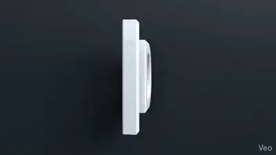
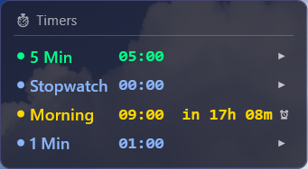
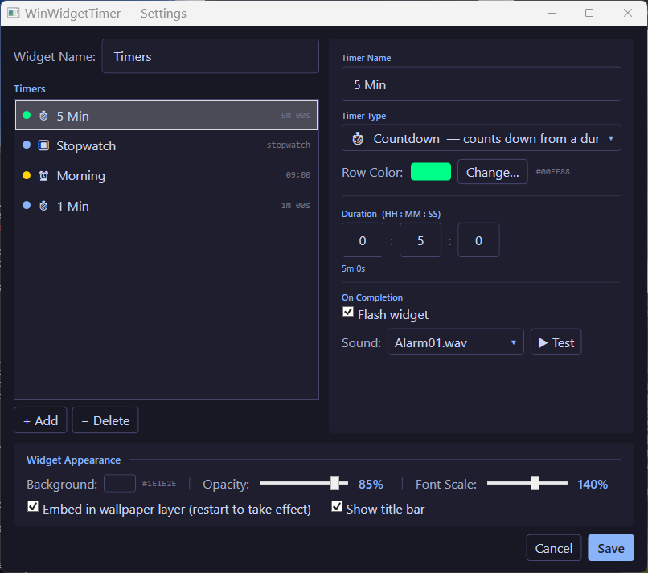

<table border="0">
  <tr>
    <td>
      17-May-2026<br>
      Windows<br>
      <a href="https://landenlabs.com/index.html">Home</a>
    </td>
    <td>
      <a href="https://landenlabs.com/index.html">
        
      </a>
    </td>
  </tr>
</table>

# WinWidgetTimer

[](https://github.com/landenlabs/win-widget-timer/actions/workflows/build.yml)


A lightweight Windows desktop timer widget that floats on your wallpaper as a transparent overlay.
Supports three independent timer types — countdown, stopwatch, and daily alarm — each with its own
color, sound, and flash-on-completion settings.

**By [LanDen Labs](https://github.com/landenlabs) (2026)**

---

## Screenshots

**Timer widget on desktop**



**Settings dialog**



---

## Features

- **Three timer types** — countdown, stopwatch (elapsed), and daily alarm in a single widget
- **Per-timer notifications** — individual sound file and flash-on-completion for each timer
- **Multiple widgets** — add as many independent timer groups as needed via the system tray
- **Transparent overlay** — sits directly on the desktop wallpaper, no taskbar clutter
- **Per-timer colors** — assign a custom color to each timer row
- **Drag to reorder** — reorder timers in the settings list via drag handle
- **Multi-monitor aware** — position saved per monitor layout; snaps to a safe position if the saved location is off-screen
- **Screen-map position picker** — drag a scaled widget marker across a miniature monitor map inside Settings to reposition the widget *(Windows 10 & 11 — see [Windows 10 notes](#windows-10-notes))*
- **Drag to reposition** — click and drag the widget anywhere on the desktop *(Windows 11)*
- **Background color & opacity** — live-preview color and transparency while Settings is open
- **Font scale** — adjust text size 50–200%
- **Show / hide title bar** — toggle the widget header on or off
- **Wallpaper embed mode** — render the widget at the wallpaper layer (below all windows)
- **Auto-start on login** — optional launch with Windows (a *Startup apps* entry when installed from the MSIX)
- **Dark theme** — Catppuccin Mocha palette throughout
- **Persistent settings** — saved to `%AppData%\WinWidgetTimer\settings.json`

---

## Requirements

- Windows 10 or Windows 11 (x64 or ARM64)
- No .NET install needed for the release builds — the MSIX and zip are self-contained
- Framework-dependent builds from source need the [.NET 10.0 Desktop Runtime](https://dotnet.microsoft.com/en-us/download/dotnet/10.0)

---

## Windows 10 Notes

### Drag limitation

On **Windows 10**, the desktop widget cannot be dragged directly on screen. This is caused by a Windows 10 incompatibility between WPF's `AllowsTransparency` and `WindowStyle="None"` — the combination that transparent widgets require. The drag operation silently fails.

**Windows 11** does not have this limitation; direct drag works normally.

### Workaround — Screen-map position picker

Open **Settings** (hover the widget and click ⚙, or right-click → Settings) and scroll to the **Widget Position** panel at the bottom:

```
Widget Position ─────────────────────────────── X: 120  Y: 200
┌──────────────────────────────────────────────────────────────┐
│  ┌────────────────────────────┐  ┌─────────────────────┐    │
│  │  Primary                   │  │  2560×1440          │    │
│  │        ▓▓▓▓▓               │  └─────────────────────┘    │
│  └────────────────────────────┘                              │
└──────────────────────────────────────────────────────────────┘
  Drag the blue marker to reposition the widget — it moves live.
```

- The canvas shows **all connected monitors** scaled to fit
- The **blue marker** represents the widget at its current position
- Drag the marker to the desired location — **the widget moves live** as you drag
- Click **Save** to keep the new position, or **Cancel** to restore it
- The X / Y coordinates update in real-time as you drag

This approach works on Windows 10 because the Settings dialog is a normal opaque window that does not require transparency.

---

## Installation

See **[how-to-install.md](how-to-install.md)** for full details — every install option, why the MSIX is signed with a self-signed certificate, which Windows security features (SmartScreen, Smart App Control) can still block the app, and how to uninstall.

### Option A — MSIX installer (recommended)

1. From [Releases](https://github.com/landenlabs/win-widget-timer/releases) download `WinWidgetTimer-<version>-x64.msix` (or `-arm64.msix`) and `install-msix.ps1` into the same folder
2. Run it from a normal (non-admin) PowerShell:
   `powershell -ExecutionPolicy Bypass -File .\install-msix.ps1`
   It picks the `.msix` matching your CPU, trusts its self-signed certificate (one UAC prompt), installs, and launches the app. It shows up in the Start menu as **WinWidgetTimer**.

> Windows only installs an MSIX whose signing certificate is trusted, so the self-signed certificate must be added to **Local Machine → Trusted People** first — the script does this for you.
> To remove the app and the certificate later: `powershell -ExecutionPolicy Bypass -File .\uninstall-msix.ps1`

### Option B — Portable release zip

1. Download `WinWidgetTimer.zip` from [Releases](https://github.com/landenlabs/win-widget-timer/releases)
2. Right-click the zip → **Properties** → tick **Unblock** → **OK**
3. Extract to any folder (e.g. `C:\opt\bin\winwidgets\`) and run `WinWidgetTimer.exe`

> The zip contains a single self-contained `WinWidgetTimer.exe` (assets bundled inside) — no .NET runtime needed. The exe is unsigned, so SmartScreen may warn (**More info → Run anyway**).

### Option C — Build from source

```cmd
git clone https://github.com/landenlabs/win-widget-timer.git
cd win-widget-timer
build.bat C:\opt\bin
```

`build.bat <dest-dir>` publishes a self-contained single-file exe to `<dest-dir>\winwidgets\` and writes a `<dest-dir>\WinWidgetTimer.bat` launcher. With no argument it uses the `BINDIR` environment variable.

---

## Usage

### Widget controls

| Action | Result |
|--------|--------|
| **Click timer row** | Start, pause, or reset that timer |
| **Hover** | Reveals ⚙ Settings and ? About buttons |
| **Drag** | Repositions the widget *(Windows 11 only — use Settings on Windows 10)* |
| **Right-click** | Opens context menu (Settings / About / Add / Remove / Exit) |

### Timer row icons

| Icon | State |
|------|-------|
| ▶ | Running |
| ⏸ | Paused |
| ↺ | Idle / reset |
| ✓ | Countdown complete |
| 🔔 | Alarm fired |

---

## Settings

Open Settings via the hover button or right-click menu.

### Timer list (left panel)

- **Widget Name** — label shown in the title bar and system tray
- **Timers** — all timers for this widget; click to select and edit
- **+ Add / − Delete** — add a new countdown timer or remove the selected one
- **Drag** the grip handle (⠿) to reorder timers

### Timer properties (right panel)

| Field | Description |
|-------|-------------|
| Timer Name | Display label for the row |
| Timer Type | Countdown, Elapsed, or Alarm (see below) |
| Row Color | Color of the dot and name text |
| Duration | HH : MM : SS — for Countdown timers |
| Alarm Schedule | Day of week + HH : MM — for Alarm timers |
| Time Format | Display format string (e.g. `HH:mm:ss` or `ddd HH:mm`) |
| Flash widget | Flashes the widget border red when the timer completes |
| Sound | WAV file from `C:\Windows\Media\` to play on completion |
| ▶ Test | Preview the selected sound immediately |

### Timer types

| Type | Icon | Behavior |
|------|------|----------|
| **Countdown** | ⏱ | Counts down from the configured duration to zero, then fires |
| **Elapsed** | ⏹ | Stopwatch — counts up from zero; click to start / pause / reset |
| **Alarm** | 🔔 | Fires once per day (or on a specific weekday) at the configured time |

### Widget Appearance (bottom panel)

| Setting | Description |
|---------|-------------|
| Background | Background fill color |
| Opacity | Background transparency 0–100% — updates live |
| Font Scale | Text size relative to default 50–200% — updates live |
| Embed in wallpaper layer | Anchors the widget behind all desktop icons (requires restart) |
| Show title bar | Toggles the widget name header |
| Auto-start on login | Launch the widget when Windows starts |

### Widget Position (bottom of Settings — Windows 10 workaround)

A miniature map of your monitor layout. Drag the **blue marker** to move the widget anywhere on any screen. The widget repositions live as you drag. Coordinates are shown in the header. Changes are applied on **Save** and reverted on **Cancel**.

Settings are saved to `%APPDATA%\WinWidgetTimer\settings.json`.

---

## Building from Source

### Prerequisites

- [.NET 10 SDK](https://dotnet.microsoft.com/en-us/download/dotnet/10.0)
- Windows (WPF requires a Windows build host)

### Build

```cmd
dotnet build WinWidgetTimer.csproj -c Release
```

### Publish (FDD single-file, win-x64)

```cmd
dotnet publish WinWidgetTimer.csproj -c Release -r win-x64 --self-contained false -p:PublishSingleFile=true
```

Output: `bin\Release\net10.0-windows10.0.17763.0\win-x64\publish\`

This produces a **single `WinWidgetTimer.exe`** (all managed assemblies bundled) plus the `Assets\` folder. Users need only the .NET 10 Desktop Runtime — no SDK required.

### Build and install via batch script

```cmd
build.bat <dest-dir>
```

Kills any running instance, publishes a self-contained, compressed single-file exe (the same build as the release zip), copies it to `<dest-dir>\winwidgets\`, and writes a `<dest-dir>\WinWidgetTimer.bat` launcher. `<dest-dir>` defaults to the `BINDIR` environment variable.

### Build the MSIX locally

```powershell
powershell -ExecutionPolicy Bypass -File .github\scripts\build-msix.ps1 -Arch x64 -Version 6.11.20 -PfxPath cert.pfx -PfxPassword secret
```

The certificate subject must equal the package Publisher (default `CN=LanDen Labs`). The package is written to `dist\`. Requires the Windows 10/11 SDK (`makeappx.exe`, `signtool.exe`).

### Releases

Pushing a `v*` tag runs [.github/workflows/build.yml](.github/workflows/build.yml). It publishes the portable zip and signed x64 + ARM64 MSIX packages, and attaches them to a GitHub release together with `install-msix.ps1`, `uninstall-msix.ps1` and (for self-signed builds) `WinWidgetTimer.cer`. If the repo secrets `MSIX_CERT_BASE64` (base64 `.pfx`) and `MSIX_CERT_PASSWORD` are set, that certificate signs the packages; otherwise a self-signed `CN=LanDen Labs` certificate is generated for the build.

---

## Project Structure

```
WinWidgetTimer/
├── Models/
│   ├── AppSettings.cs          # Top-level settings (list of widgets)
│   ├── DisplayConfiguration.cs # Multi-monitor position tracking
│   └── TimerEntry.cs           # Per-timer data model
├── Services/
│   ├── AutoStartService.cs     # Run on login (Run key, or MSIX StartupTask)
│   ├── DesktopService.cs       # Wallpaper embed / Win32 window helpers
│   ├── DisplayService.cs       # Per-monitor position save/restore
│   ├── SettingsService.cs      # Load/save settings.json
│   └── TrayIconService.cs      # System tray icon
├── ViewModels/
│   └── TimerDisplayItem.cs     # Live timer binding per row
├── Windows/
│   ├── AboutWindow.xaml        # About dialog
│   ├── ColorPickerWindow.xaml  # Color picker dialog
│   ├── SettingsWindow.xaml     # Settings dialog (incl. screen-map position picker)
│   └── WidgetWindow.xaml       # Main widget overlay
├── Assets/
│   ├── landenlabs.mp4          # Animated logo (About dialog)
│   └── landenlabs.png          # Static logo fallback
├── .github/
│   ├── workflows/build.yml     # Release build: zip + signed MSIX (x64, arm64)
│   └── scripts/build-msix.ps1  # MSIX packaging and signing
├── screens/icon.png            # Source image for the MSIX logos
├── build.bat                   # Build and install portable exe locally
├── install-msix.ps1            # Trust certificate + install MSIX (end users)
├── uninstall-msix.ps1          # Remove MSIX + its self-signed certificate(s)
└── how-to-install.md           # Install options, certificate and security notes
```

---

## Credits

| Component | Source |
|-----------|--------|
| Timer logic | Custom countdown / stopwatch / alarm engine |
| Desktop embedding | Win32 `WorkerW` technique |

---

## Privacy

No accounts, ads, analytics, telemetry or tracking. See [privacy.md](privacy.md) for exactly what the app reads, stores and (if anything) sends.

---

## License

Apache 2.0 © [LanDen Labs](https://github.com/landenlabs) 2026
