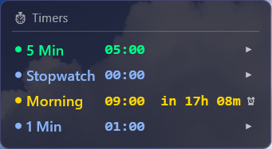
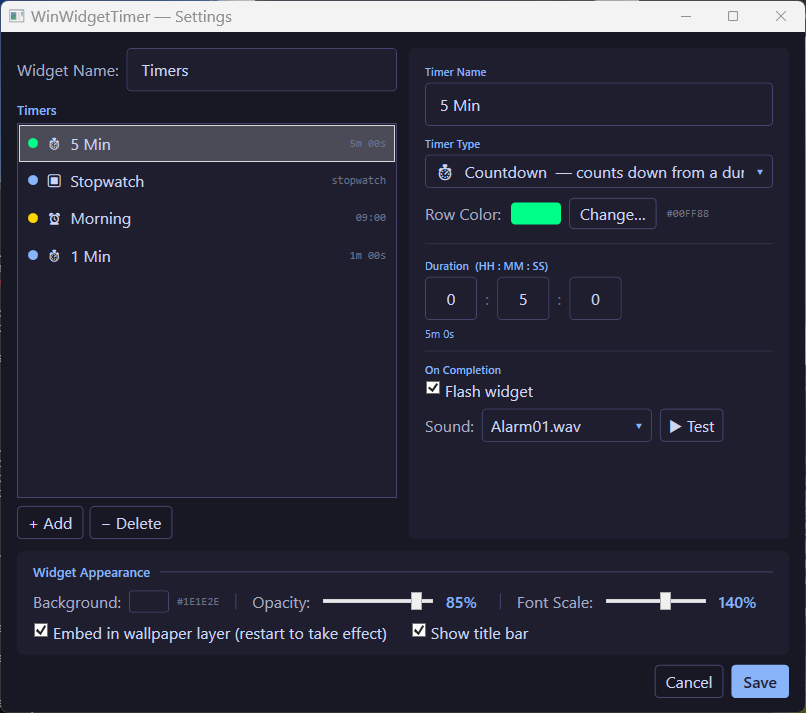

# WinWidgetTimer

A lightweight, transparent desktop widget with countdown, stopwatch and daily alarm timers, shown
right on your wallpaper.

- **Three kinds of timer:** countdown, stopwatch and daily (or weekday) alarm, side by side in one
  widget.
- **Alerts your way:** each timer can play its own Windows sound and flash the widget when it
  finishes.
- **Yours to style:** a color per timer, background color, opacity, font scale and title bar. Drag a
  corner to scale the widget. Run several widgets on several monitors.
- **Private by design:** no account, no ads, no telemetry, and no internet connections. See the
  [privacy policy](privacy.html).
- **Free and open source** under the Apache 2.0 license.

## Download

Windows 10 or 11, x64 or ARM64. No .NET runtime needed.

- [Download the portable zip](https://github.com/landenlabs/win-widget-timer/releases/latest/download/WinWidgetTimer.zip):
  extract it and run `WinWidgetTimer.exe`
- [All releases](https://github.com/landenlabs/win-widget-timer/releases): MSIX installers (x64 and
  ARM64) and older versions
- [Installation help](https://github.com/landenlabs/win-widget-timer/blob/main/how-to-install.md)

## Using it

| Action | Result |
| --- | --- |
| Click a timer row | Starts, pauses or resets that timer |
| Hover | Shows the Settings (⚙) and About (?) buttons |
| Drag the widget | Moves it (Windows 11; on Windows 10 use the position map in Settings) |
| Drag a bottom corner | Scales the widget (any corner when the title bar is hidden) |
| Right-click | Settings, About, Remove, Exit |
| System tray icon | Add another widget, open Settings, or exit |

## Support

- [Report a problem or ask a question](https://github.com/landenlabs/win-widget-timer/issues)
- [Source code and documentation](https://github.com/landenlabs/win-widget-timer)
- [Privacy policy](privacy.html)

&copy; 2026 LanDen Labs. Licensed under Apache-2.0.
